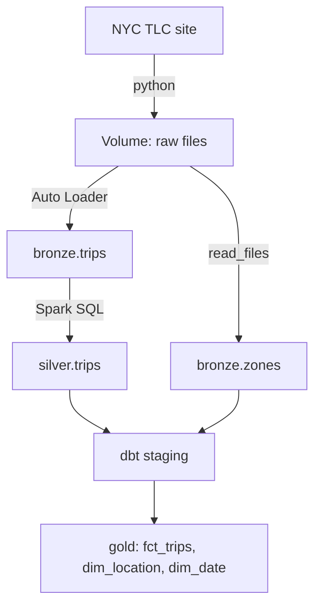

# nyc-taxi-pipeline

Batch pipeline on Databricks that loads NYC yellow taxi trips, cleans them, and builds a star schema with dbt. Runs as one scheduled Databricks job.

## Architecture



Job tasks: `download` -> `bronze_trips` + `bronze_zones` (parallel) -> `silver_trips` -> `dbt_build`. Scheduled monthly.

## Stack

- Databricks Free Edition: serverless compute, Unity Catalog, Volumes, Delta tables, Jobs
- Python for ingestion
- PySpark Auto Loader for bronze
- Spark SQL for silver
- dbt-databricks 1.13 for gold and tests
- GitHub, with Databricks Git folders

## Layers

**Raw.** Monthly Parquet files stored as `year=YYYY/month=MM/`. The download script finds the next month that isn't there yet and fetches only that one. It writes to a temp file and renames it when finished, so a failed download never leaves a broken file.

**Bronze.** Trips are loaded with Auto Loader. The checkpoint remembers which files were already loaded, so reruns don't duplicate data. Each row gets `_source_file` and `_ingested_at`. The zone lookup is one small CSV, so it's fully reloaded each run.

**Silver.** Renames columns, drops impossible rows (dropoff before pickup, pickup outside the file's month), turns 0 passengers into NULL, flags negative fares and zero-distance trips instead of deleting them, and removes exact duplicates.

**Gold.** Star schema built with dbt:
- `fct_trips`: one row per trip
- `dim_location`: taxi zones
- `dim_date`: calendar covering every full year that has trips

## Data quality

- 14 dbt tests: unique, not null, and relationships between the fact and dimensions
- Profiling notes in `docs/data_profiling.md`
- Jan to May 2024: 16,792,900 rows in bronze, 16,792,509 in gold. 390 impossible rows dropped and 1 exact duplicate removed.

## Decisions

- Hash surrogate keys instead of identity columns, so rebuilding a table gives the same keys every time
- `date_key` as a `yyyymmdd` integer, so the fact table can build it straight from the pickup timestamp
- Left joins from the fact to dimensions, so a trip with an unknown location isn't silently dropped
- Duplicates removed in silver, so everything downstream gets clean data
- dbt Core v1 locally and in the job, because the Databricks dbt task runs v1. Same version in dev and prod.
- One month per run, to stay inside Free Edition compute limits

## Repo layout

```
ingestion/   python download scripts
notebooks/   databricks notebooks for download, bronze, silver
dbt/         dbt project for gold models and tests
docs/        profiling notes
```

## Running locally

```
py -3.12 -m venv .venv
.venv\Scripts\activate
pip install -r requirements.txt
cd dbt
dbt build
```

Needs a dbt profile named `nyc_taxi` pointing at a Databricks SQL warehouse.

## Next

- Salesforce as a second source, with an SCD2 client dimension
- Incremental silver and fact table instead of full rebuilds