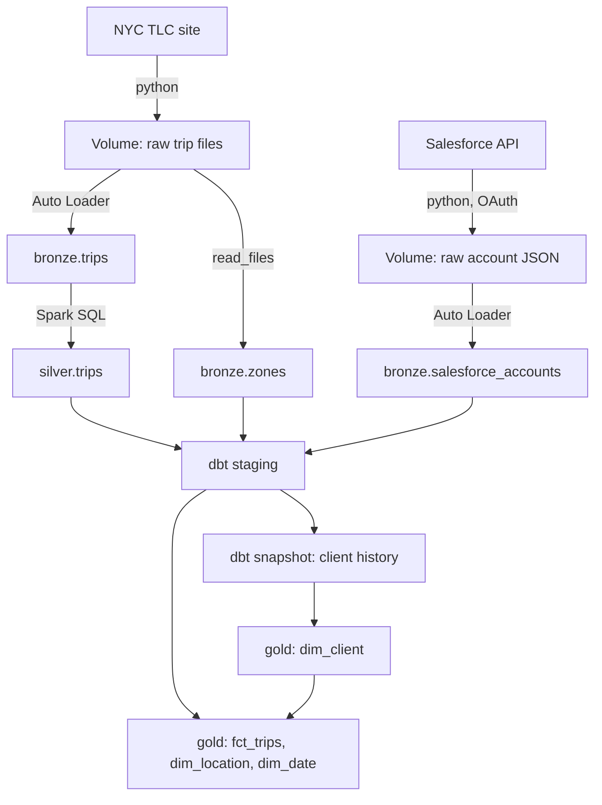

# nyc-taxi-pipeline

Batch pipeline on Databricks that loads NYC yellow taxi trips and Salesforce client data, cleans them, and builds a star schema with dbt, including a slowly changing client dimension (SCD2). Every layer is incremental, and the whole thing runs as one scheduled Databricks job.

## Architecture



Job tasks: `download` and `download_accounts` start in parallel. Taxi data flows through `bronze_trips` and `bronze_zones` to `silver_trips`. Salesforce data flows through `bronze_accounts`. Everything meets at `dbt_build`. Scheduled monthly.

## Stack

- Databricks Free Edition: serverless compute, Unity Catalog, Volumes, Delta tables, Jobs, secret scopes
- Python for ingestion (files and REST API)
- PySpark Auto Loader for bronze
- Spark SQL for silver
- dbt-databricks 1.13 for gold, snapshots, and tests
- Salesforce Developer Edition as a SaaS source
- GitHub, with Databricks Git folders

## Sources

**NYC taxi trips.** Monthly Parquet files from the NYC TLC. Each run downloads the next month that isn't in the Volume yet. If the TLC hasn't published it, the run finishes cleanly without it.

**Salesforce accounts.** 20 fictional corporate clients with industry, pricing tier, and account manager. The extract logs in with the OAuth 2.0 client credentials flow through an External Client App (new Connected Apps are disabled by default since Spring '26, and username/password login is gone from API v65). It keeps a watermark on `SystemModstamp` and only pulls accounts changed since the last run, follows `nextRecordsUrl` for paging, and uses `queryAll` so deleted accounts come through too. Credentials live in a Databricks secret scope, and in a git-ignored `.env` file locally.

## Layers

**Raw.** Trip files stored as `year=YYYY/month=MM/`. Account extracts stored as one JSON file per run. Both are written to a temp file first and renamed when complete, so a failed run never leaves a broken file.

**Bronze.** Auto Loader for trips and accounts. The checkpoint remembers which files were loaded, so reruns don't duplicate data. Each row gets `_source_file` and `_ingested_at`. The zone lookup is one small CSV, fully reloaded each run.

**Silver.** Only months that are new or reloaded in bronze get processed, written with `INSERT INTO ... REPLACE WHERE`, which swaps out exactly that month in one transaction. Cleaning rules: drop impossible rows (dropoff before pickup, pickup outside the file's month), turn 0 passengers into NULL, flag negative fares and zero-distance trips instead of deleting them, and remove exact duplicates.

**Gold.** Star schema built with dbt:
- `fct_trips`: one row per trip, incremental `merge` on `trip_key`, only processing rows newer than the last load
- `dim_location`: taxi zones
- `dim_date`: calendar covering every full year that has trips, growing with the data
- `dim_client`: one row per version of each Salesforce account, from a dbt snapshot

## SCD2 client dimension

A dbt snapshot (timestamp strategy on `SystemModstamp`) closes the old row and inserts a new one whenever an account changes. `dim_client` gives each version its own key by hashing the account id with its valid-from time.

Trips join to the client version that was valid at pickup time. Example: Northgate Media moved from Standard to Gold, but its 2024 trips still report as Standard, because that was its tier when the trips happened.

Two honest notes:
- History only exists from when tracking started. A client's first version is treated as valid from the beginning of time, so older trips still find a client. Changes made before the first snapshot can't be recovered.
- Taxi trips have no client, so about 30% of trips are assigned to a client by a hash of `trip_key`. It's synthetic, but stable: the same trip always gets the same client.

## Data quality

- 25 dbt tests: unique, not null, and relationships between the fact and every dimension
- Profiling notes in `docs/data_profiling.md`
- Jan to May 2024: 16,792,900 rows in bronze, 16,792,509 in gold. 390 impossible rows dropped and 1 exact duplicate removed.

## Decisions

- Hash surrogate keys instead of identity columns, so rebuilding a table gives the same keys every time
- `date_key` as a `yyyymmdd` integer, so the fact table can build it straight from the pickup timestamp
- Left joins from the fact to dimensions, so a trip with an unknown location isn't silently dropped
- Duplicates removed in silver, so everything downstream gets clean data
- `>=` on the Salesforce watermark, so changes made in the same second aren't missed. The repeats get deduplicated in staging.
- dbt Core v1 locally and in the job, because the Databricks dbt task runs v1. Same Python and dbt version in dev and prod.
- One taxi month per run, to stay inside Free Edition compute limits

## Repo layout

```
ingestion/    python extract scripts (taxi files, zones, salesforce)
notebooks/    databricks notebooks for download, bronze, silver
dbt/          dbt project: staging, snapshots, gold models, tests
salesforce/   seed file for the fictional client accounts
docs/         profiling notes
```

## Running locally

```
py -3.12 -m venv .venv
.venv\Scripts\activate
pip install -r requirements.txt
cd dbt
dbt build
```

Needs a dbt profile named `nyc_taxi` pointing at a Databricks SQL warehouse, and a `.env` file with `SF_DOMAIN`, `SF_CLIENT_ID`, and `SF_CLIENT_SECRET` to run the Salesforce extract.


## CI/CD

- **CI:** every pull request runs `databricks bundle validate` and a full `dbt build` with all tests, into a separate `gold_ci` schema so production tables are never touched.
- **CD:** every merge to `main` runs `databricks bundle deploy`, which updates the job from `resources/nyc_taxi_pipeline.job.yml`. The job definition lives in Git, so nothing is configured by hand in the Databricks UI.

## Setup on a new machine

1. Clone the repo and run `pip install -r requirements.txt` in a Python 3.12 venv
2. Create `~/.dbt/profiles.yml` with a `nyc_taxi` profile, and a `.env` with the Salesforce credentials (neither is in Git)
3. Run `databricks auth login`

Deploying doesn't need any of this. Merging to `main` deploys automatically.


## Security

- The job runs as a dedicated service principal, not a personal account. It owns the pipeline's schemas, tables, and volume, has read-only access to the Salesforce secret scope, and has no admin rights.
- GitHub Actions logs in as the same service principal with OAuth (client ID and secret stored as GitHub secrets). No personal tokens are used in CI/CD.
- Three environments: `gold_dev` for local development, `gold_ci` for pull request tests, and `gold` for production, which only the job changes.
- Free Edition note: views can't be transferred to a service principal there, so they were dropped and recreated by dbt running as the service principal.
- Known shortcut: the bundle deploys to `/Workspace/Shared`, which every workspace user can edit. Fine for a one-person workspace. In a team, deploys would go only through CI into the service principal's own folder.